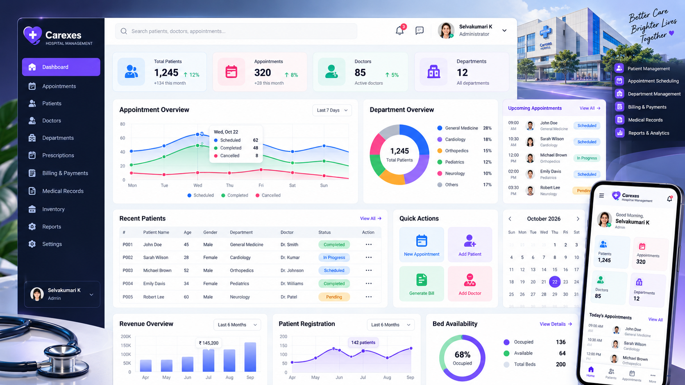
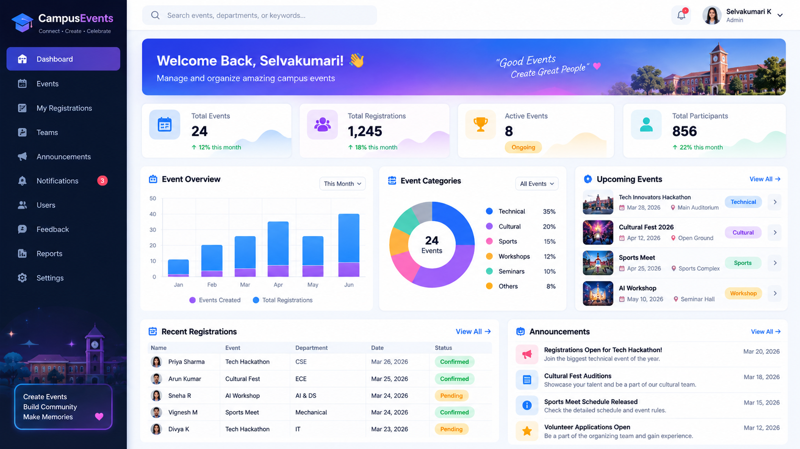
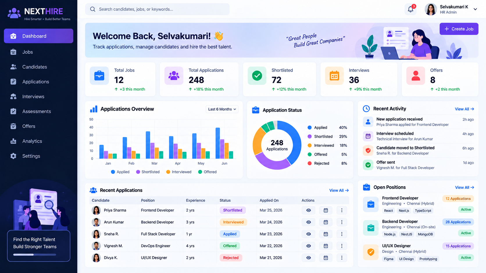

  

  <b>Entry-Level Full Stack &amp; Backend Developer</b> &nbsp;|&nbsp; NestJS · TypeScript · React · Node.js
   
  📍 Chennai, Tamil Nadu, India

  
  
  
  

## 👩‍💻 About Me

I'm a **B.Tech Artificial Intelligence and Data Science (2026)** graduate from **Gnanamani College of Technology** (CGPA 8.3) with two internships in **NestJS/TypeScript backends** and **MERN-stack development**.

- 🐞 Fixed **20+ bugs** in an existing NestJS/TypeScript e-commerce and delivery backend
- 🗄️ Contributed to a **MinIO → SeaweedFS** storage migration using an S3-compatible API
- 🤖 Integrated **Gemini** and **Groq** APIs for AI-powered features
- 🎯 Looking for an entry-level **Full Stack or Backend Developer** role where I can contribute to real products and keep growing

## ⭐ Featured Projects

<table>
<tr>
<td width="50%" valign="top">
  <h3>🏥 Carexes — Hospital Management Platform</h3>
  
 <i>Illustrative dashboard preview</i>

  
Microservices backend: a REST gateway talking to auth and patient services over gRPC. Angular frontend in progress.

  <ul>
    <li>REST <b>API gateway</b> calling auth and patient services over <b>gRPC</b></li>
    <li>Register/login with <b>bcrypt</b> and <b>JWT</b></li>
    <li>Patient records in <b>MongoDB</b>, reports stored in <b>MinIO</b></li>
    <li><b>Docker</b>-containerised services with <b>Kubernetes</b> + <b>Istio</b> (mTLS) manifests and <b>GitHub Actions</b> CI</li>
  </ul>
  

    
    
    
    
    
  

  
<a href="https://github.com/SELVAKUMARI-737/Carexes"><b>📂 View Repository →</b></a>

</td>
<td width="50%" valign="top">
  <h3>💰 Personal Expense Tracker — Finly</h3>
  
 <i>Illustrative dashboard preview</i>

  
Full-stack expense tracker with a REST API, MongoDB storage, charts and an AI assistant.

  <ul>
    <li>Signup/login with <b>bcrypt</b>-hashed passwords</li>
    <li>Add, edit and delete expenses with optional <b>receipt upload</b></li>
    <li>Salary tracking and a <b>Chart.js</b> dashboard with <b>PDF export</b></li>
    <li><b>AI assistant</b> powered by the <b>Groq</b> API</li>
  </ul>
  

    
    
    
    
    
  

  
<a href="https://github.com/SELVAKUMARI-737/finly"><b>📂 View Repository →</b></a>

</td>
</tr>
<tr>
<td width="50%" valign="top">
  <h3>🎟️ Campus Event Management</h3>
  
 <i>Illustrative dashboard preview</i>

  
Event portal (ZVENT) with separate student and admin experiences.

  <ul>
    <li><b>Student</b> and <b>admin</b> roles with session login and <b>bcrypt</b></li>
    <li>Admins create, edit and delete events and post announcements</li>
    <li>Students register for events with a <b>capacity check</b></li>
    <li><b>QR code</b> per registration, scanned by admins for check-in</li>
  </ul>
  

    
    
    
    
    
  

  
<a href="https://github.com/SELVAKUMARI-737/campus-event-management"><b>📂 View Repository →</b></a>

</td>
<td width="50%" valign="top">
  <h3>🧭 NEXTHIRE — Application Tracking System</h3>
  
 <i>Illustrative dashboard preview</i>

  
Job-application tracker with a React frontend and a JWT-secured REST API.

  <ul>
    <li><b>JWT</b> register/login with <b>bcrypt</b> and <b>express-validator</b></li>
    <li>Create, view, update and delete job applications</li>
    <li>Status tracking: <b>Applied · Interview · Rejected · Selected</b></li>
    <li><b>React</b> + <b>Vite</b> frontend with protected routes</li>
  </ul>
  

    
    
    
    
    
  

  
<a href="https://github.com/SELVAKUMARI-737/NEXTHIRE"><b>📂 View Repository →</b></a>

</td>
</tr>
</table>

## ⚡ Tech Stack

<table>
<tr>
<td width="24%"><b>Languages</b></td>
<td>

</td>
</tr>
<tr>
<td><b>Frontend</b></td>
<td>

</td>
</tr>
<tr>
<td><b>Backend &amp; APIs</b></td>
<td>

</td>
</tr>
<tr>
<td><b>Databases &amp; Storage</b></td>
<td>

</td>
</tr>
<tr>
<td><b>Authentication &amp; Security</b></td>
<td>

</td>
</tr>
<tr>
<td><b>Testing &amp; Dev Tools</b></td>
<td>

</td>
</tr>
<tr>
<td><b>DevOps</b></td>
<td>

</td>
</tr>
<tr>
<td><b>AI Integrations</b></td>
<td>

</td>
</tr>
</table>

## 💼 Experience

### Backend Developer Intern — Wentrite Technologies Pvt. Ltd.
📍 Chennai &nbsp;·&nbsp; 📅 Jul 2026 – Sep 2026 &nbsp;·&nbsp; NestJS · TypeScript · GraphQL · MongoDB · Redis · SeaweedFS

- Fixed **40+ bugs** in existing modules of the BOBO NestJS/TypeScript backend (a multi-application e-commerce and delivery platform) and tested each fix to confirm expected behaviour.
- Worked on **NestJS guards** for route protection and authorization; integrated and validated existing **GraphQL/REST** endpoints (MongoDB, Redis) using **Postman**.
- Contributed to a **MinIO → SeaweedFS migration**: replaced MinIO-specific code with a shared `StorageService`/`StorageModule`, updated dependent modules, and configured SeaweedFS through its S3-compatible API (AWS SDK).
- Validated uploads, presigned-URL downloads and deletion; worked on bucket-access policies, safe file extensions and private KYC storage; added and validated unit and S3-compatible tests; updated the Docker Compose dev config.
- Worked on real-time **WebSockets** features and integrated the **Gemini API** for recipe generation.

### MERN Stack Developer Intern — Cybernaut
📍 Remote &nbsp;·&nbsp; 📅 Jun 2025 – Sep 2025 &nbsp;·&nbsp; React · Node.js · Express · MongoDB · JWT

- Built **JWT + bcrypt.js** authentication, **15+ REST APIs** and Mongoose schemas for a MERN application, with a React.js frontend consuming the APIs.
- Integrated the **Groq API** for intelligent recommendations; used Git feature branches and took part in code reviews.

## 🎓 Education &amp; Certifications

**B.Tech — Artificial Intelligence and Data Science** · Gnanamani College of Technology · 2026 · **CGPA 8.3**

**Certifications**
- NPTEL — Internet of Things (IoT), 90%
- ICT Academy — Java (2025)
- GUVI — Python (2023)
- GUVI — Git

**Community:** Technical Volunteer, Devtoops Community — supported technical events and collaborative developer learning.

## 🎯 Current Focus

- 🅰️ **Learning Angular** and building the Angular frontend for Carexes *(in progress)*
- 🔧 Improving backend and API quality, testing and debugging practices
- 🧠 Preparing for technical interviews

## 🤝 Let's Connect

I'm open to suitable entry-level **Full Stack** and **Backend Developer** opportunities. If my work looks like a fit for your team, I'd love to hear from you.

  
  
  
  

